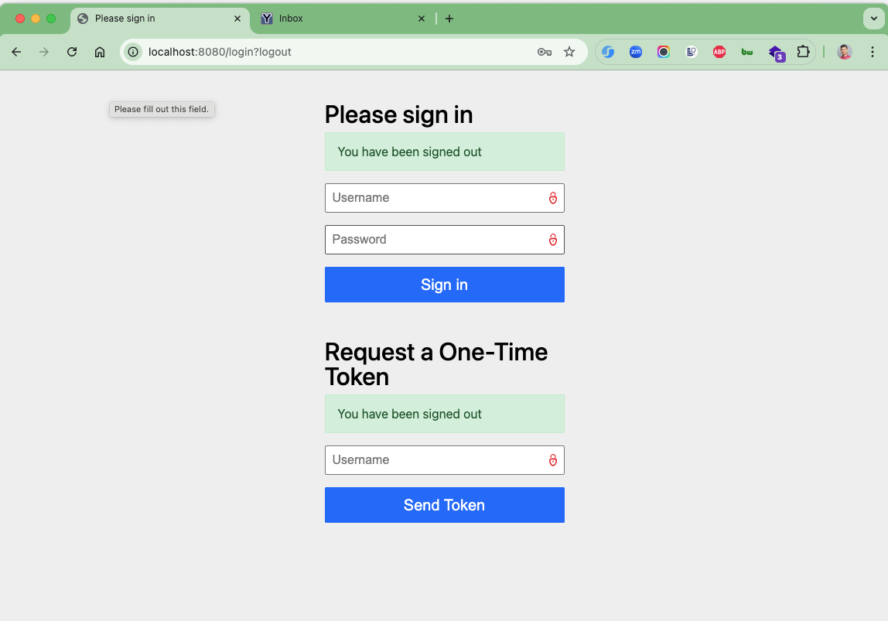
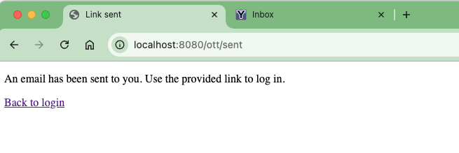
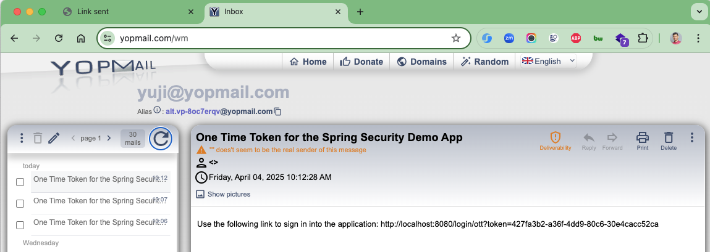
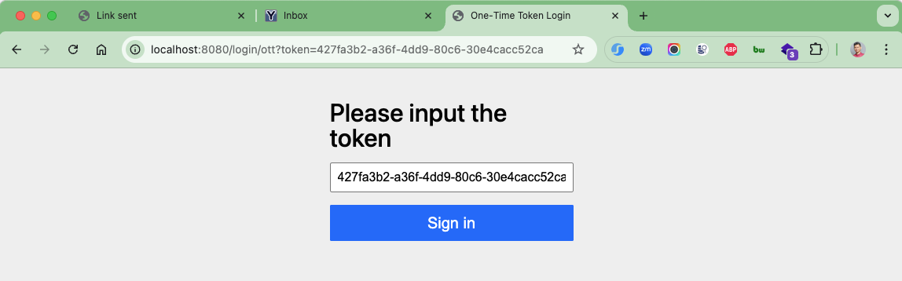
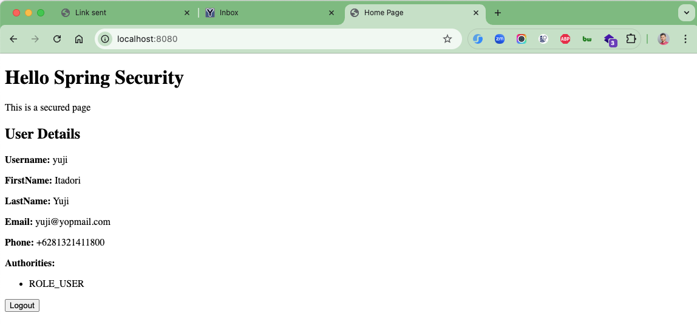

# spring-boot-one-time-token

[](https://github.com/hendisantika/spring-boot-one-time-token/actions/workflows/maven.yml)


In Spring Security, a One-Time Token (OTT) is a server-side generated string that can be used only once for user
authentication purpose. It is delivered to the user typically via email or SMS in the form of a magic link, on which
user can click to login into the application. The OTT mechanism allows a user to log in without entering a password.

Please note that a one-time login URL will only work once. If we need access to login again or in another device/browser
then we need to generate the OTT link again.

Also, unlike OTP (One-Time Password) that are generated by an external tool (e.g. authenticator apps), OTT do not
require any external tool for generating or validating the tokens.

### Tech Stack

- Java 25
- Spring Boot 4.1.2 (Spring Framework 7)
- Spring Security 7 (One-Time Token Login)
- Spring Data JPA + H2 (in-memory)
- Spring Mail + Thymeleaf
- Maven 3.10 (via Maven Wrapper)

### Prerequisites

- JDK 25 (e.g. [Eclipse Temurin 25](https://adoptium.net/temurin/releases/?version=25))
- An SMTP account (e.g. Mailtrap or Brevo) configured in `src/main/resources/application.properties`:

```properties
spring.mail.host=<smtp-host>
spring.mail.port=<smtp-port>
spring.mail.username=<smtp-username>
spring.mail.password=<smtp-password>
```

> Do not commit real SMTP credentials. Prefer environment variables such as `SPRING_MAIL_USERNAME` and
> `SPRING_MAIL_PASSWORD`.

### Things to do list

1. Clone this repository: `git clone https://github.com/hendisantika/spring-boot-one-time-token.git`
2. Navigate to the folder: `cd spring-boot-one-time-token`
3. Run the application: `./mvnw clean spring-boot:run`
4. Open your favorite browser: http://localhost:8080

### Build & Test

```shell
./mvnw clean package
```

### CI/CD & Dependency Management

- **GitHub Actions** (`.github/workflows/maven.yml`) builds and tests the project on JDK 25 (Temurin) for every push
  and pull request to `main`, and submits the Maven dependency graph on pushes to `main`.
- **Dependabot** (`.github/dependabot.yml`):
    - Maven dependencies are checked daily (05:00 Asia/Jakarta) and grouped into `spring-boot`, `maven-plugins` and
      `minor-and-patch` updates.
    - Spring Boot major upgrades are ignored, since they need a manual migration.
    - GitHub Actions are checked weekly (Monday) and grouped into a single PR.
    - PRs are labelled and use Conventional Commit prefixes (`build(deps)`, `ci(deps)`).

### Image Screenshots

Login Page



Email Sent





Token Page



Secured Page


